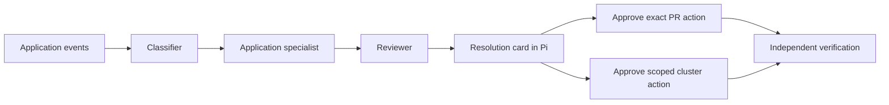

# Pi as a shared agent workspace

The original proactive example uses a synthetic checkout application. The comparison we want is the complete workflow: observe application failures, classify them, hand them to an application specialist, review its proposed resolution, obtain a human decision, then independently verify the result.

## Current lab

Pi shows standalone Pi agents and this retained native kagent investigator/reviewer pair. Agent execution, native task records and actor snapshots stay in Kubernetes. The bridge translates observations and decisions for Pi.

Real TypeSafe Jev classifications automatically dispatched the native pair. This retained trial uses a scripted model and a separate protected synthetic fixture. Its human approved it at 10:22 UTC; after repairing strict revision conversion, the same native task verified one committed synthetic effect. The original exception bodies and source are not supplied to its fixture investigation. The comparison thread `01a1346a-4185-7ee2-94f4-6a03b7926f8f` reported a separate live Kimi investigator/reviewer run on 14 October; that does not change this trial's model or evidence.

Skills lists the selected AgentTemplate's declared skills and pinned sources, plus system instructions. Both current templates declare no skills. Declared sources and actual runtime loading are separate evidence. Models lists namespace ModelConfigs, identifies the selected scripted route and labels alternatives as configured. Tools lists template bindings and controller-discovered descriptions, with human-approval requirements. Complete tool schemas are absent from controller discovery.

The VM timer `dpi-kagent-capabilities.timer` refreshes metadata every minute using the existing kubeconfig. It reads no Secrets and invokes no agent or provider. The pane shows observation time and warns when a loaded inventory is more than two minutes old. Refresh inventory reads the latest observation.

The approval card explains the recorded cause, change, expected result, affected scope, reviewer verdict and approval/rejection consequences. The decision includes the displayed task, confirmation ID and full publish request. Missing, stale or mismatched bindings return HTTP 409. Controller and independent fixture checks remain in force.

## Application specialist and SDLC

The new **Lumen GitLab rollback** workspace implements this handoff for a real synthetic checkout Deployment, a private GitLab MR and Flux reconciliation. Jev dispatch, native investigation, real MR creation, exact-head CI, native reviewer PASS, human approval, merge and application recovery are verified. The specialist's Workflow results view formats these receipts, with the full native transcript available separately. See [GITLAB-ROLLBACK.md](GITLAB-ROLLBACK.md). The comparison fixture described above remains a separate workspace.

An application template should identify its application, cluster, namespace, repository, deployment ownership, telemetry locations and approved diagnostic/repair routes. Put reusable instructions in pinned skills and select MCP tools for those locations. The incident handoff should include raw failure evidence, classification/confidence, event IDs, revision and timestamp. The specialist collects supporting evidence and proposes a resolution; a reviewer checks that exact proposal and its tests.

The archived 1 October rig used PM/builder/tester/reviewer agents, A2A handoffs, issue admission, CI and a draft MR. Its historical receipt records parent issue 53, child 54, a tested commit, draft MR 14 and reviewer PASS. That concerns the older rig, not a current Pi integration. The standalone Pi coordinator in `apps/dpi-sdk/scripts/TWO-AGENT-HANDOFF.md` preserves investigator/reviewer handoffs; its release-check publishes synthetic App State notes, with no Git-provider merge or deployment integration.

Reuse those stages as native task/artifact events. A PR decision should include a real PR URL, repository, target branch, head commit, diff summary, CI/test links, reviewer verdict and exact requested action. Proposal approval, PR review approval and merging are separate actions. Bind a merge decision to the reviewed head commit; changed commits require fresh review and approval.

A cluster decision should name cluster, namespace, resource, exact patch, expected effect, rollback and verification. This lab's synthetic card authorizes only one protected fixture operation.

## Durability, context and shared access

Persistent configuration and sessions let users return later. Actors can pause or suspend while idle. Native TaskStore uses PostgreSQL and the Harness configures object-store snapshots. Bridge rollouts retained the same task and approval; this is not proof of Proxmox host-loss recovery.

Pi implements automatic context compaction and keeps stored history. On 14 October the Mac's two sessions returned enabled compaction settings. The visible Proxmox Pi session showed 200,000-token background and 250,000-token blocking thresholds. These are live settings observations, not a freshly forced compaction test.

The native Harness has no explicit compaction policy and the cluster had no CronJobs at inspection. Native automatic compaction and long-session continuity remain unverified. Actor suspension/resource cleanup and conversation compaction are different operations.

This personal hub uses device tokens. Workplace shared access needs individual identity, role checks, task ownership/concurrency, approver attribution and an audit record. A shared browser view alone does not establish those controls.

## Verification

Frontend type/build checks and lint passed. Ten interpretation tests cover blocked effects, controller identity, review gating, independent readback, readable proposal binding and stale-decision rejection. Live capture rejects wrong-task, non-boolean, missing-binding and stale-proposal requests without choosing a valid decision. Current private receipts are in `.data/live-proof.json`.

The pane now includes a separate **Live Kimi chat** workspace with specialist and reviewer composers. The first browser round trip used a native MCP read and live diagnosis; a follow-up retained the native context. This chat has read-only incident tools and its own persistent eight-request/20,000-token model allowance. See [LIVE-CHAT.md](LIVE-CHAT.md).
