# Connection choices

## HTTP from a separate workstation

```mermaid
flowchart LR
  Browser[Browser: Pi pane] --> Hub[Workstation Pi hub]
  Hub -->|Authenticated HTTP and SSE| Bridge[Remote cluster: Pi bridge]
  Bridge -->|Native gRPC and A2A| Kagent[Existing kagent controller]
  Kagent --> Agents[Native specialist and reviewer]
  Agents -->|MCP Streamable HTTP| Tools[Scoped app and GitLab tools]
  Tools --> App[Synthetic checkout]
  Tools --> GitLab[Dedicated GitLab repository and CI]
  GitLab --> Flux[Existing Flux controllers]
  Flux --> App
```



The workplace endpoint the Pi hub connects to is the bridge's HTTP service, not the controller's gRPC port. The bridge calls the controller inside Kubernetes. Only bridge HTTP needs to cross between machines.

The browser talks to the local hub. The hub adds the bridge bearer token. GitLab credentials stay in the tools pod's mounted Secret. Native agents use separate role capabilities; the reviewer has no write tools. The bridge has the control capability required to record a human decision independently of the native approval extension.

## Port-forward first

```sh
python3 scripts/connect.py port-forward --profile profile.json --state .state/install
```

This forwards the selected remote Service to 127.0.0.1:4798 using the profile's exact kube context. It does not change the current context. Keep bridge_url at http://127.0.0.1:4798. The UI hub can run on that workstation at http://127.0.0.1:4781.

The forwarding process must remain running. A broken connection must show as offline or a connection error; it must not silently switch endpoints. On reconnection, preserve both PVCs and the same profile/native identities.

For a controller protocol canary, forward the approved controller separately and run scripts/probe-native.py inside the runtime container with the script mounted. This is a read-only version/task check; it does not create a session or invoke a model. The native controller is not a browser-facing HTTP API.

## Existing AKS Istio ingress

Use the existing Gateway. Verify its namespace/name, HTTP listener or TLS termination, accepted host, ingress address and workplace access policy. Set istio_gateway to namespace/name when the Gateway is in a different namespace. Set istio_host to the approved dedicated host and bridge_url to its complete URL.

```sh
python3 scripts/istio-route.py --profile profile.json > .state/virtual-service.json
kubectl --context APPROVED_CONTEXT create --dry-run=server -f .state/virtual-service.json
```

Review the exact route before creating it through the approved deployment process. The route targets only RUN_ID-bridge.AGENT_NAMESPACE.svc.cluster.local:8080. It preserves the Authorization header and uses timeout 0s for event streams. The generator does not create a Gateway, enable an AKS add-on, alter ingress authentication or change cluster-wide mesh policy.

HTTP is suitable for a loopback port-forward. Use the workplace's approved TLS/access policy for a routed endpoint. Match the VirtualService host with the Gateway; setting a host in the profile alone does not create DNS or a certificate. Test both authenticated API requests and long-lived SSE through the actual route before using it for a demo.

Internal routes needed by this bundle:

| Caller | Destination | Purpose |
| --- | --- | --- |
| Workstation hub | Bridge HTTP 8080 via forward/ingress | Pi API, job actions and SSE |
| Bridge pod | Existing controller native port, normally 8083 | Session APIs and A2A tasks/approval |
| Controller discovery and agent actors | Scoped tools HTTP 8080 | Role-authenticated MCP |
| Bridge pod | Tools HTTP 8080 | Workflow state and independent human ledger |
| Tools pod | Kubernetes API and checkout HTTP 8080 | Read deployment, logs, Flux and real probes |
| Tools pod | Configured GitLab v4 API | Repository, MR, CI, exact-head merge |
| Existing model runtime | Existing approved model route | Specialist and reviewer model calls |
| Existing Flux controllers | Dedicated GitLab repository | Image reconciliation |

Apply existing mesh/network policy through the workplace process. Do not turn off mTLS or open all egress to make a probe pass. If current policy prevents the required native/HTTP hops, identify that exact blocked hop and propose the smallest scoped change.

## Primary references

The optional ingress route follows the [AKS Istio ingress documentation](https://learn.microsoft.com/en-us/azure/aks/istio-deploy-ingress). Literal URL: https://learn.microsoft.com/en-us/azure/aks/istio-deploy-ingress.

Native tool approval is configured on the [kagent 1.x tool binding](https://kagent.dev/docs/kagent/1.x/skills-and-mcp/about-tools/). Literal URL: https://kagent.dev/docs/kagent/1.x/skills-and-mcp/about-tools/.

The [0.x to 1.x migration guide](https://kagent.dev/docs/kagent/1.x/operations/upgrade-from-0x/) describes the resource/API distinction. This bundle does not perform that migration. Literal URL: https://kagent.dev/docs/kagent/1.x/operations/upgrade-from-0x/.
